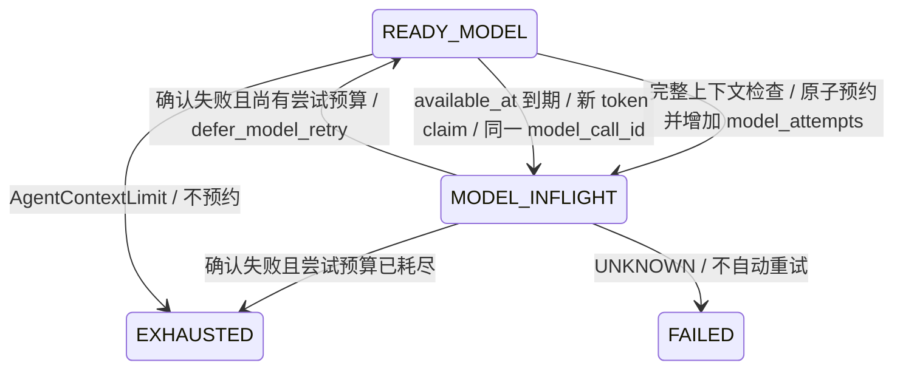
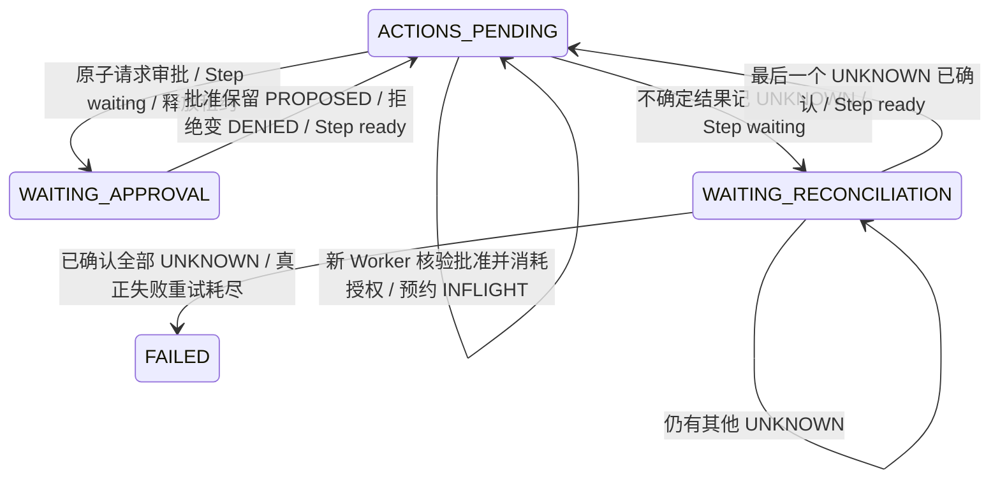

# 持久执行语义

## Evidence-Anchored Context Checkpoint

可选确定性证据摘录见 [Evidence Checkpoint](evidence-checkpoint.md)。默认关闭，仅来自持久 StepSpec。
完整历史先经 ContextBuilder 验证，UNKNOWN 永不因旧轮次省略而绕过；有限摘录在 user 角色承载，无授权能力。
Store 在模型预约事务中重算来源与整个投影视图，引用/Manifest 与 Attempt、RequestContract 原子保存。
复用既有 JSON，旧记录无新增键，不修改历史迁移；新引用计入 Session 配额并保留取消/UNKNOWN 清理余量。
模型已确认失败才能以相同身份重试，确认丢失依旧 fail-closed，不重复请求。
完整审计不删除；摘录不等于事实认证或生成式摘要，可能丢失语义且不保证模型推理正确。
字节上限不等于精确 Token 或费用上限，外部模型与工具不具备 exactly-once 保证。

## 事务与恢复

注册的工作流版本不可变，运行保存定义快照、输入、独立步骤状态和输出检查点。
成功步骤不会在正常恢复时重新执行。未成功步骤通过数据库队列重新领取。

领取事务将 ready 改为 running，同时增加 attempts、生成 token 并设置 lease_until。
worker 每隔租约长度的三分之一续租。PostgreSQL 使用数据库时钟判断租约，
避免多个 worker 主机时钟不同步。SQLite 使用本机时间，仅用于单机学习模式。

超时、普通异常、租约过期都消耗一次尝试。未超过 max_attempts 时延迟重试，
退避为 retry_delay × 2^(attempts-1)，上限 3600 秒；耗尽后失败并取消下游。
独立分支仍能完成。工作流只有所有步骤都成功才为 succeeded。

## 至少一次，不是副作用恰好一次

如果工具已发送外部请求，但进程在写成功检查点前崩溃，引擎无法知道外部请求是否完成。
恢复时可能再次执行该步骤。这是 at-least-once 的必然边界。

有副作用的 handler 应使用稳定的 `Task.idempotency_key`，或将外部操作与业务
去重记录放在同一个受控事务中。新 token 只能防止旧执行覆盖检查点，不能撤销
已经发送的邮件、支付或文件写入。

运行取消会使租约失效，协作式 handler 在下次心跳发现后取消；已经发生的外部
副作用不会回滚。用户编写的 handler 必须传播 CancelledError，不应阻塞事件循环。
DockerSandbox 取消时会删除对应容器。

## 审批与版本

审批不是暂存在内存中的 Future，而是数据库资源。审批通过/拒绝具有终局性，
同一决定的重放不会再次执行状态迁移；相反决定产生冲突。已取消运行不能恢复审批。
每个成功的 artifact 步骤只产生一个制品，输出和成功状态原子提交。

运行 ID 同时作为业务修订标识；制品包含内容 SHA-256。数据库中不提供覆盖版本的 API。
本版没有跨工作流的语义 diff 或自动合并，后续修订应创建新运行。

## 容量边界

每个工作流最多 500 步，每个 JSON 输入/输出最多 2 MB。
本版在事务中扫描单个 run 的步骤，适合学习和中小规模工作流；大量超宽 DAG
应通过基准分析后再做增量依赖计数。没有实现跨地区共识、自动分片或分布式事务。

## Durable AgentStore（PR2）

先运行 Alembic `upgrade head`，再部署本版代码；迁移 `0002` 仅新增四张 Agent 表，
不会改变 `0001` 的 Workflow/Step 数据。回退至 `0001` 会删除 Agent 数据，旧工作流数据保留。
未选择 Durable 模式的 AgentRunner 继续保持原有行为；不提供等待步骤的通用恢复入口。

应用依赖 `application.ports.agent_store.AgentStore`；实现为
`SQLAgentStore(existing_store)`，复用同一 Engine、事务和数据库时钟。
Task 的 `step_id` 是步骤 key，Store 先按 `(run_id, key)` 找到真实 StepRow UUID，
Session 的唯一外键绑定该 UUID。锁顺序为 Run → Step → AgentSession → 模型记录 → Action。
同一 Run 的事务会串行化，这是当前可靠性边界，尚未针对超宽并行 Agent 做吞吐优化。

- `open(task, initial_snapshot, messages=...)`：只接受未使用的 READY_MODEL 快照；
  同一 Step、相同初始化幂等返回现状，冲突初始化不会覆盖历史。
- `load(task)`：校验当前租约后恢复快照、全部有序消息、全部逻辑模型调用和历史 Action。
- `commit_transition(task, AgentTransition(...))`：校验旧快照和修订号，调用 `old.advance(candidate)`，
  再用独立 revision 列执行 CAS；消息、模型调用、Action 和快照在同一事务写入。
- `complete_agent_step(task, transition, output)`：SUCCEEDED、Step 输出、Artifact 及下游调度原子提交。
- `fail_agent_step(task, transition)`：FAILED/EXHAUSTED 与 Step failed 原子提交，不重开终态 Agent。
- `suspend_agent_step(task, transition)`：等待快照与 Step waiting 原子提交并释放 token/租约。
  现有 Workflow 审批入口不能任意恢复 Agent 等待步骤；授权恢复由后续 PR 设计。

每次模型请求先提交 READY_MODEL → MODEL_INFLIGHT，逻辑调用 ID 与轮次固定；
确认失败的重试复用 ID 并使 attempts 恰好加一。未知模型结果不能直接预约重试。
成功模型结果必须附带一条 assistant 消息，其 `payload.action_ids` 与有序批次完全一致。
ActionArguments 必须逐个匹配新批次；规范 JSON SHA-256 必须与领域摘要相符。
`arguments_digest` 用于一致性校验，**不是加密，也不是数据脱敏**。参数、消息和结果仍是敏感存储数据。

ActionObservation 指定追加 sequence 和 result（可为 JSON null），Store 根据 Action 生成
`tool` 消息：`action_id/status/error_code/result`。状态、结果和观察不可分开提交。
序号从 0 开始连续追加，不允许覆盖已有消息；历史 Action 不因下一模型轮次清空当前批次而删除。
幂等键由 Session/Action ID 确定，跨恢复保持稳定，但是否去重仍取决于外部工具。
模型 usage 是当前逻辑调用最近一次结果的供应商无关 JSON；资源预算由调用方按固定单位累积，
本层不推断实际 token、费用或失败请求是否被供应商计费。

所有 Task 写入在开始和提交前检查租约；租约或 token 失效抛 LostLease，修订号/状态/记录冲突抛
StateConflict，非法或超大 JSON 抛 AgentDataError。数据库驱动故障抛 AgentStoreUnavailable，
提交结果可能未知，必须恢复租约后重读，不能直接执行外部调用。不会静默覆盖，异常不携带原始参数输出。
消息、工具参数、单个结果及 usage 各限 100 KB；快照和单次提交限 2 MB；累计会话 JSON 限 8 MB。
活动会话还预留取消/崩溃时记录 UNKNOWN 与观察的容量，防止历史填满后无法安全停止。
只保存有限 JSON，不使用 pickle，拒绝 NaN/Infinity。事件只包含步骤 key、状态、修订号和安全错误码。

普通非 Agent Handler 的 Step 重试/失败行为保留。已有 Session 时：

- 进程在模型预约后退出：新 Worker 接管同一 Session，模型记录为 UNKNOWN，预算/ID 不重置；
  DurableRunner 将其保留为 UNKNOWN 并 fail-closed 终止，不静默重发。
- 工具派发后结果未持久化便失去租约：全部 INFLIGHT 转 UNKNOWN，Agent/Step 原子等待对账，
  不自动再次派发。WAITING_RECONCILIATION 不允许任何 INFLIGHT；先对账返回 ACTIONS_PENDING 才能派发。
- Workflow 取消：活动 Agent 转 CANCELLED，未确认工具结果先记 UNKNOWN，释放执行所有权。
- Handler 抛异常或 Step 恢复尝试耗尽：Agent/Step 终态失败，保留未知结果，不套用会重开 Agent 的普通重试。

终态 Agent 快照不可修改；后续到达的结果只能通过下述操作员对账事务另存审计证据。
数据库不能保证所有外部工具 exactly-once。

验证使用 SQLite 与专用临时 PostgreSQL 的同一组 AgentStore 测试。`scripts/verify_postgres.py`
会运行普通 PostgreSQL、AgentStore 并发/fencing/回滚以及 0001↔0002 迁移测试；SQLite 不模拟行锁。

## DurableAgentRunner（PR3）

仅在 `StepSpec.parameters.agent.mode = "durable_v1"` 时启用。CLI 将现有 Worker Store
传入组合根，`SQLAgentStore(store)` 复用连接池；同步数据库调用全部在线程中执行。
旧的两参数 handler_factory 继续可用；支持 `store` 关键字的工厂会收到共享 Store。
不指定模式时仍使用原 AgentRunner，不改变普通 Handler 的返回值和重试规则。

```json
{"prompt":"Summarize the supplied data", "tools":["read_text"],
 "agent":{"mode":"durable_v1", "max_model_rounds":8,
          "max_model_attempts":12, "max_tool_calls":32}}
```

Agent ID 由 Run/Step 身份确定；初始化目标和依赖输出作为 user 数据持久化，恢复时验证
同一初始化。系统消息仅由应用生成。预算和 Action 身份从持久状态恢复，不按 Worker 尝试重置。
PR3 强制模型轮次、请求尝试和工具派发次数预算；usage 保留供应商报告值，未知值为 null。
没有实现费用或 token 的资源计价策略，因此 Runner 的 `max_resource_units` 只接受 0，
表示未启用该项计价，不能将其宣称为费用上限。Domain/AgentStore 的独立资源结算能力保持不变。

每次模型请求先原子预约 MODEL_INFLIGHT，提交后再核对当前租约并发出请求。响应、模型记录、
有序 Action 和 revision 原子保存。工具顺序执行；先校验白名单、Schema 和部署时声明的副作用策略，
再预约 INFLIGHT 并增加 tool_calls，提交后核对租约才派发。派发前必须留有下一模型轮次和请求预算，
因此最后一轮的工具提案会耗尽终止，不先产生副作用。合法最终回答只接受无工具调用、非空文本及
finish_reason=stop；length 截断不能完成。成功仍由 AgentStore 原子提交 Agent、Step 和 Artifact。

`ModelProvider.complete()` 保持旧消息协议，Durable 模式使用 `respond() -> ModelResponse`，
包含 assistant_message、finish_reason、usage、model 和 request_id。DeepSeek 不做内部重试；
MockProvider 可以注入类型化响应和明确错误。MockTransport 测试只验证 HTTP 契约，不代表真实模型联调。

### 审计历史与模型上下文

assistant payload 保存规范消息、finish_reason、供应商元数据和有序 `action_ids`。
核心 Action ID 由 Runner 生成；供应商 tool_call ID 原样留在该条消息内，映射作用域是
`(model_call_id, call_index)`，不要求供应商 ID 跨轮唯一。恢复派发前也校验映射和参数，
缺失映射的 PR2 手工会话无法安全升级执行，必须停止，不能猜测 ID 或重新生成行动。

AgentContextBuilder 在每次模型调用前重建上下文。assistant 的工具调用 ID 替换为核心 Action ID，
对应 tool 响应也使用相同 ID。每个已解决 Action 只按最新 StoredAction 结果回放一次，
按模型轮次及 call_index 排序；数据库中 UNKNOWN 和后续对账观察全部保留。
任何未解决 Action（包括 UNKNOWN）均阻止下一模型请求。工具输出始终作为 tool 内容编码，
不会将输出中的 role、action_id、status 或审批字样解释成系统指令或执行权限。

非法 JSON、重复参数键、非对象或非有限参数保留原始 assistant 调用；对应 Action 使用空参数摘要
作为不可执行的拒绝记录，invalid_arguments 标记其格式错误。每次恢复派发都重新解析原始参数，
不依赖该标记授权执行。Action 随后转 DENIED，附安全结构化错误；修正必须来自下一轮的新 Action。
参数摘要用于一致性校验，不是加密或脱敏。消息、参数、结果仅进入受限持久存储，不进入事件或日志。

### 错误与恢复矩阵

| 情况 | 持久化结果 | 后续行为 |
| --- | --- | --- |
| 已确认可恢复模型失败（429、连接建立失败） | ModelCall failed，READY_MODEL，Step ready / 未来 available_at，释放租约 | 同一逻辑 ID 有界延期重试，增加模型 attempts |
| 模型读取超时、5xx、未知异常或恢复中的模型预约 | ModelCall unknown，Agent/Step FAILED | 不重发；请求可能已被供应商计费 |
| 模型配置、无效响应协议、空/截断回答 | ModelCall failed，Agent/Step FAILED | 不重试，不保存异常正文 |
| 参数格式/Schema 错误 | Action DENIED，tool_calls 不增加 | 安全错误反馈模型，在总预算内创建新 Action |
| 未授权或策略变更的工具 | Action DENIED，tool_calls 不增加 | 不执行；Step 级审批不授予后续行动权限 |
| 需审批或 UNSAFE 工具 | Action 保持 PROPOSED，Agent/Step 等待审批 | 仅绑定该行动的批准可授权一次预约 |
| ToolConfirmedFailure（适配器确认的失败） | Action FAILED、观察原子保存 | 反馈模型；已失败 Action 不重新派发 |
| 工具超时、未知异常、非法/超大结果、执行中取消 | Action UNKNOWN，Agent/Step 等待对账 | 不再请求模型或派发此行动 |
| 调用次数预算耗尽 | Agent EXHAUSTED、Step FAILED | 不重开 Agent，不走整步异常重试 |
| 规范上下文超过 max_context_bytes | Agent EXHAUSTED、Step FAILED，AgentContextLimit | 预约前停止，模型尝试数不增加，不删减历史 |
| LostLease / StateConflict / AgentStoreUnavailable | 不尝试覆盖、不走普通 Store.fail | 停止；由租约恢复重读持久事实 |

Tool 默认副作用为 UNSAFE。Durable 模式中的 UNSAFE 或 requires_approval 工具必须先获得
持久行动批准；其他工具仍须通过部署者声明的副作用策略、白名单和 Schema 校验。
`Tool.invoke_durable(arguments, ToolInvocation)` 可接收稳定 Action ID 和幂等键；
普通 invoke 保留兼容性。工具适配器只有确认失败时才抛 ToolConfirmedFailure，其他执行异常视为 UNKNOWN。
不从 StepSpec.requires_approval 推导行动授权；旧 AgentRunner 的调用协议保持兼容。

Worker 接受绑定当前 Task 的 CommittedAgentResult，并读取数据库核对 Agent revision、终态/等待状态、
Step 状态及已释放租约，随后不再 complete/fail。不存在提交的标记会被拒绝；并发取消造成的状态变化
作为冲突停止处理。租约失效或提交结果未知不转成普通 Handler 失败。模型/工具执行中的协程取消会在
仍持有有效租约时保守记录 UNKNOWN；若租约已失效，由 Store 的取消/过期恢复事务记录 UNKNOWN。

仍存在数据库提交与外部派发之间的不可原子窗口：租约核对不能撤回已经发出的请求，不能保证外部
exactly-once。崩溃在预约后、派发前也可能保守进入 UNKNOWN。终态不可重开；晚到结果需另存审计证据。
下述操作员事务先解决 UNKNOWN 并返回 ACTIONS_PENDING，才可派发尚未执行的 Action。
没有任意恢复 waiting Step 的入口。

临时 PostgreSQL 验证脚本同时执行新 Runner/Worker 集成、接管 fencing 和真实子进程退出测试。
真实模型 API、Docker sandbox 和 Compose 仍需各自的环境验证，不能用 SQLite 或 MockTransport 代替。

### 持久模型治理（PR5）

配置仍来自提交时持久化、不可变的 StepSpec；恢复使用相同配置。三个限制分别生效：

| 配置 | 默认值与范围 | 含义 |
| --- | --- | --- |
| max_model_rounds / max_model_attempts / max_tool_calls | 8 / 12 / 32，非负整数 | Session 跨 Worker 的累积调用预算 |
| max_context_bytes | 1,000,000，正整数 | 每次请求的完整消息及工具 Schema 的 JSON UTF-8 字节上限 |
| retry_base_seconds / retry_max_seconds | 1 / 60，有限正数，base ≤ max ≤ 3600 | 同一逻辑调用第 n 次确认失败后的 min(max, base × 2^(n−1)) 秒等待 |

Runner 只将累积预算字段传给 AgentBudget。退避和上下文限制不是可消费预算，也不会在恢复时重置计数。
DeepSeek 429 的非负、有限数值 Retry-After 可延长等待，但始终受 retry_max_seconds 限制；
无效数值及 HTTP 日期形式忽略，使用本地策略。适配器没有隐藏重试，ModelRetryableError() 的旧构造仍可用。



`AgentStore.defer_model_retry(task, transition, retry_delay_seconds) -> AgentSession` 仅接受当前
MODEL_INFLIGHT、原模型记录仍为 inflight 的确认失败，目标 READY_MODEL，且尚有模型尝试预算。
它复用 Run→Step→Session→审批→ModelCall→Action 锁顺序，验证有效 token、数据库时钟租约、
revision CAS 和 old.advance(candidate)。模型 failed、Snapshot、Step ready、数据库当前时间加 delay、
continuation_pending=true、清除 token/lease 与元数据事件在一个事务提交；提交失败整笔回滚。
事件不包含 Prompt、异常/供应商响应正文或凭据。UNKNOWN 不可通过该入口改写为可重试失败。

Runner 返回 CommittedAgentResult(status="retry_scheduled") 后结束本次执行，不持有 Worker 等待退避，
不在事务内 sleep。Worker 读取数据库确认 READY_MODEL、revision、ready Step、释放的租约、确认失败的模型记录
和 continuation_pending，随后不调用普通 complete/fail。若新 Worker 已领取或 Workflow 已取消，验证冲突即停止。
claim 使用已保存 available_at，重启不重新计算等待；一次性 continuation 标记使正常内部模型尝试不增加
Step attempts。model_attempts 每次真实预约增加，model_rounds 与 model_call_id 在重试中保持不变。
真正的进程租约失败仍受 Step max_attempts 约束；普通 Handler 的 retry_delay 和失败重试规则不变。

每次 Provider 调用之前，ContextBuilder 先完成已有的 UNKNOWN 阻断、工具结果去重与角色规范化。
对 `{"messages": [...], "tools": [...]}`（没有工具时省略 tools）使用
ensure_ascii=False、allow_nan=False、separators=(",", ":") 序列化，再精确计算 UTF-8 字节数。
完整工具 Schema、工具调用 ID、工具结果字符串内的 JSON 转义都计入；等于上限允许，超过一字节即拒绝。
这定义的是供应商无关的上下文载荷，不包括 model、max_tokens、HTTP headers 等供应商配置，也不是 token 估算。
不同模型的实际 token 窗口和费用仍需部署者配置；8 MB 存储配额和单项消息限制另行生效。

超限在模型预约前通过 fail_agent_step 原子提交 EXHAUSTED / Step failed，错误码 AgentContextLimit。
model_attempts 不增加，历史 Action、消息、工具结果和审计均保留，不截断、不隐式删除或提升消息角色。
后续若引入上下文压缩，须在 ContextBuilder 之后提供独立、可验证的变换，并再次执行同一硬限制；
本阶段没有摘要模型请求或长期 Memory。

崩溃在延期事务前：保留 MODEL_INFLIGHT，租约恢复按 UNKNOWN fail-closed，不伪称已安排重试。
崩溃在延期提交后：新进程保留原时间与调用 ID，到期后正常领取。数据库提交响应丢失时以持久事实为准，
不声称成功；同步数据库线程仍需部署端连接/语句超时。外部模型请求与数据库不能原子化，
未知结果可能已计费；延期策略不能保证 exactly-once，也不重发 UNKNOWN。

### 取消信号与有界清理

Python 协程取消与 Workflow 业务取消分开处理。DurableRunner 在等待模型或工具时收到
CancelledError，会尽力持久化未知结果，随后始终重抛原始 CancelledError，保留取消原因。
外层 asyncio.timeout 因此能产生 TimeoutError，Worker 关闭也不会被伪装成正常返回。

| 取消来源 | 持久状态 |
| --- | --- |
| 模型请求中的协程取消/步骤超时 | 有效租约下记录模型 UNKNOWN，Agent/Step fail-closed 失败 |
| 工具执行中的协程取消/步骤超时 | 有效租约下 INFLIGHT → UNKNOWN，Agent 等待对账、Step waiting，释放租约 |
| Workflow 业务取消 | Store.cancel 原子提交 CANCELLED 和未确认工具 UNKNOWN；旧 Runner 不得覆盖 |
| 清理失败、租约失效、冲突、二次取消或清理等待超时 | 原始取消继续传播，不声称清理成功；保留数据库事实，由租约恢复处理 |

清理协程直接在调用者中等待，最多等待 5 秒；不创建 shield 后脱离调用者的 asyncio Task，
不调用 uncancel 隐藏取消。第二次取消可以提前停止等待。同步数据库线程无法被协程强制终止，
底层数据库操作可能在调用者退出后返回；仍使用旧 Task/token/revision，且提交前再次检查数据库租约。
5 秒限制的是协程等待，不是数据库驱动线程的强制终止；数据库连接/语句超时需由部署环境约束。
线程延迟返回不授予新所有权，也不能据此声称外部副作用 exactly-once。

Worker 的 asyncio.timeout 会把取消转换为步骤 TimeoutError。Store.fail 在有效执行所有权下
发现已有 AgentSession 时，对该超时返回 False、不提交失败，避免将工具等待对账覆盖成终态，
也避免清理未完成时绕过 AgentStore 做整步重试。清理已成功时，原 token 已释放，同样拒绝重复写入。
未创建 AgentSession 的普通 Handler 仍按原规则失败/重试；旧 AgentRunner 的取消传播保持不变。

## 行动审批与人工对账（PR4）

`0003_agent_action_review` 在 `agent_actions` 新增可空 `tool_binding`，新增
`agent_action_approvals` 和 `agent_action_reconciliations`，并在 Session 新增默认 false 的
`continuation_pending`。审批具有 Session/Action 唯一约束，
部分唯一索引保证每个 Session 只有一个 pending 请求；对账请求 ID 唯一，每个 Action 至多有
一份实际改变状态的对账记录；正式对账的 previous_status 必须是 UNKNOWN（领域与数据库约束）。
外键绑定真实 Session/Action，不使用 Step key 代替数据库 Step ID。
升级不推断旧行动的工具版本或授权：binding 为 NULL 的旧提案不能派发。
回退 0003→0002 会删除审批/对账审计、binding 和续执行标记，保留 Workflow、Step、Session、消息及行动；
有审计留存要求时必须先导出备份，并停止所有 Worker 后回退。重新升级不会恢复已删除的审计。



`request_action_approval(Task, action_id, expected_revision)` 必须持有效租约，原子创建请求与等待状态。
`decide_action(approval_id, ApprovalDecision)`、`reconcile_action(session_id, action_id,
ReconciliationDecision)` 是独立操作员事务，不构造 Task 或 token。它们按
Run→Step→Session→Approval→模型记录→Action 获取锁，验证 Run 未取消、合法等待状态和 revision，
仍使用 `AgentSnapshot.advance()` 和 revision CAS。批准和可继续的对账只恢复 Step ready，Worker 必须重新
claim 获得新 token。任何旧 token、过期租约或已取消 Workflow 均不能提交晚到的执行结果。

正常审批/对账将 Session 的一次性 continuation_pending 置 true；claim 在 Session 锁内消耗标记，
复用当前 Step attempt，token 仍更新。它不是失败重试，也不重置 attempts 或 AgentBudget。
真正的租约过期消耗当前尝试，后续领取增加 attempts；普通 Handler 仍每次领取增加 attempts。
有 INFLIGHT 时，无论 max_attempts 是否已用尽，先原子记 UNKNOWN 并等待对账。若所有 UNKNOWN
已确认且这次租约失败用尽重试，最后一次对账原子提交 Agent/Step FAILED，不再派发；否则恢复 ready，
下一次 claim 作为失败重试计数。普通工具未知结果的人工确认仍属于正常续执行，受 AgentBudget 约束。

Tool 新增兼容默认值 `version="1"`。策略 SHA-256 覆盖名称、版本、JSON Schema、副作用、审批要求、
超时和描述；参数单独使用规范化 SHA-256。版本需要部署者在工具实现或安全语义变化时主动更新，
摘要不分析 Python 函数体，也不是加密或脱敏。批准绑定 Session/Action、工具名称、版本、策略与
参数摘要。`ActionExecutionContext` 从持久记录构建，不能用 approved=True、模型文本或 Step 审批替代。
通用 `commit_transition` 同样检查受保护派发的批准 ID，原子消耗批准、PROPOSED→INFLIGHT、
累计一次 tool_calls。提交失败则全部回滚；已消耗批准不能再次预约。真实工具调用前重查
当前注册版本/策略、白名单、Schema 和 Task 租约。配置变化安全拒绝，不重新生成旧 Action。

所有端点复用单租户 Bearer operator token。`actor` 只是已认证操作员提供的审计标签，
不是独立认证的用户身份；部署方负责 token 保管和工具注册。Python Store/Runtime 属于可信应用边界，
不是针对进程内恶意代码的权限隔离机制。

| 方法与路径（前缀 `/api/agent`） | 输入 / 结果 |
| --- | --- |
| GET `/action-approvals?run_id=&limit=` | 待审批绑定；limit 1–200，默认 100 |
| GET `/action-approvals/{approval_id}` | 绑定、决定、消耗时间 |
| POST `/action-approvals/{approval_id}/decision` | expected_revision、decision=approved/rejected、actor、reason |
| GET `/reconciliations/pending?run_id=&limit=` | UNKNOWN 行动及 Session revision，包括终态审计对象 |
| POST `/sessions/{session_id}/actions/{action_id}/reconciliations` | request_id、expected_revision、confirmed_status=succeeded/failed、result、安全 error_code、evidence_reference、actor、reason |
| GET `/sessions/{session_id}/reviews` | revision 与完整审批、对账审计 |

未认证 401；资源不存在 404；CAS/决定冲突 409；非法或过大数据 422（整个请求超限为 413）；
数据库不可用 503。actor 限 80 字符，reason/evidence_reference 各 1000 字符；结果限有限 JSON
100 KB，累计会话仍限 8 MB。事件只保存 ID、决定和 applied 等元数据，不保存标签、理由、证据、
Prompt、参数、工具结果或异常正文。敏感读取同样要求认证。

相同批准/拒绝决定与 actor/reason 重复提交幂等，不再次增加 revision；不同决定或标签/理由冲突。
Workflow 取消后拒绝审批，pending 请求记 cancelled。对账 request_id 与原始完整请求绑定，
相同请求重试返回原审计；复用 ID 改写内容冲突。对账证据是操作员确认，不是 Core 独立证明外部事实。
活动 Action 只能 UNKNOWN→SUCCEEDED/FAILED（FAILED 必须安全错误码），结果、追加观察、审计、
snapshot revision 与 Step 状态原子提交。多 UNKNOWN 只在最后一个解决后恢复；预算、Action ID、
幂等键与消息序号不重置。ContextBuilder 只回放最终有效观察一次，保留旧 UNKNOWN 审计消息。

FAILED/CANCELLED/EXHAUSTED/SUCCEEDED Agent 仅允许为仍是 UNKNOWN 的 Action 追加 applied=false
证据，不能改变 Snapshot、Action 结果或历史消息，也不会重启 Workflow。SUCCEEDED/FAILED/DENIED
等已知状态不能伪装为 UNKNOWN 对账；本阶段不提供已知结果的其他补充审计类型。request_id 精确重复
仍幂等，矛盾内容冲突。取消传播和 5 秒清理规则不变。
数据库事务与外部工具无法原子提交，批准消耗不保证 exactly-once；预约后派发前崩溃也保守记 UNKNOWN。
适配器仍应使用稳定幂等键，操作员必须在外部核对后再给出明确结论。

### 容量准入与恢复

新工作写入除原有取消/崩溃余量外，为每个尚未解决的 Action 预留最多三份 100 KB 结果
（Action、追加观察、正式对账）和 20 KB 对账元数据；受保护提案额外预留完整 20 KB 审批记录，
扣除已有 pending 记录的实际字节。元数据余量包含受限理由、证据、标签、ID 和 JSON 转义。
批准、拒绝、对账逐步使用这些空间；历史逼近 8 MB 时先拒绝新增工作，不等到进入人工等待后才
因控制记录不足而拒绝恢复。多 UNKNOWN 各自保留完整空间，最后一项解决前不会领取新任务。
预留会减少可用于新消息和大批行动提案的空间；容量不足在派发前明确拒绝。

8 MB 总量、100 KB 单结果和 100 KB 完整观察限制不提高；结果必须连同观察的 action_id/status/
error_code 元数据一同容纳。超限仍 422、整笔回滚，不能静默截断；操作员可明确选择 result=null，
将完整外部结果留在 evidence_reference 所指受控存储。读取只验证已存数据的实际大小，不强迫旧会话
重新满足新增预留。新预留不能追溯创造旧版本已经用满的空间：旧的逼满会话可能需要更小的显式
核对请求；连最小审计都无法容纳时需受控的离线留存处理，本阶段不提供删除历史或扩大限额的绕过。

PR4 审核时 0003 尚未合并，当时在同一迁移内扩展 schema；如今 0001–0003 均已合并，不能修改。
已经安装早期 PR 预览版 0003 的数据库必须先备份、
停 Worker，使用原预览版本的迁移文件回退到 0002，再切换新版本升级，或重建隔离预览库。
不能使用新版 downgrade 脚本回退旧版 0003（旧表尚无新增列）；upgrade head 也不会修改已打戳的 0003。
操作员文本拒绝 PostgreSQL TEXT 不支持的 NUL，输入校验返回 422，不伪装成数据库不可用。

`scripts/verify_postgres.py` 覆盖审批、对账、取消/领取竞争、CAS/fencing 与
0002→0003→0002→0003 数据保留/模型差异检查。Compose CI 停止常规 Worker 后，在 API 容器运行
`scripts/verify_action_review_compose.py`，使用真实认证 HTTP/PostgreSQL/Worker/Artifact 验证
批准、拒绝及 UNKNOWN 对账恢复；脚本的通用工具和 MockProvider 只在测试进程注册，不进入部署入口。

## v1 可靠性与发布门禁（PR6）

完整的 12 项故障窗口、现有与新增测试、共享不变量、跨 Worker/DAG 竞争、迁移验收和部署限制见
[Durable Runtime v1 验收矩阵](durable-runtime-v1-verification.md)。本阶段不增加迁移，也不改变
Domain、审批授权、UNKNOWN 或模型延期策略。

运行指标复用现有 Prometheus 设施，默认关闭，开启仍使用 AGENTFLOW_TELEMETRY。
Store 只在事务确认提交后发出状态计数；回滚不计成功，指标故障不影响执行，/metrics 保留认证。
固定状态/错误 labels 不含 Run/Agent/Action ID 或输入正文，耗时采样截在 60 秒。
独立 API/Worker 默认各自进程计数；需共享统计时，可在 Python 启动前显式设置
PROMETHEUS_MULTIPROC_DIR 并共享受保护目录/卷，沿用认证端点，不新增 Worker 服务。
停止整个部署后才能清理旧指标文件；计数可能少计、重启重置，不作为恢复事实或费用账本。

发布检查运行 `uv run python scripts/verify_postgres.py --bin <PostgreSQL-bin> --release-gates`。
它在专用临时数据库验证独立事务、旧 token 读写 fencing、提交确认丢失、三方竞争和审计恢复，
最长 600 秒，退出清理实例。CI 只在 Python 3.13 增加这组门禁，已有两个 Python 版本的基线回归不变。
数据库连接/语句超时仍由部署者配置；五秒协程清理不能强制停止已进入数据库驱动的同步线程。

## Production RC 运维验收（PR7）

[RC checklist](durable-runtime-v1-rc-checklist.md) 区分实际 PASS、FAIL、NOT VERIFIED 和不适用项；
代码合并不代表生产环境已获放行。[恢复 runbook](production-recovery-runbook.md) 提供有界三进程
稳定性、真实 pg_dump/pg_restore、只读持久核查、双宿主 staging 与显式付费 Provider 入口。
普通 CI 不发真实模型请求；长测独立手动运行，不用单机多进程冒充跨主机网络分区验证。
指标采集前退出可以少计、Collector 故障不影响数据库事实；审计输出不是精确计费或 Counter 补账机制。
本轮无新表/迁移，不放宽审批、UNKNOWN、CAS、fencing、取消传播或普通 Handler 语义。

RC 能力现已通过审核树差异集成到 main，保留原 PR 历史。Soak 诊断只记录私有租约身份，
不序列化 Task 的输入、依赖或 Prompt；审计支持不暴露 UUID 的有界整数分页，各页是独立快照。
普通 pytest 必须显式加 --run-live-provider，且授权环境变量和专用 Key 同时存在才会运行付费验收；
环境变量单独存在时仍跳过。独立脚本的 --allow-paid-request 和手动工作流默认关闭策略保持不变。

## 逐次模型尝试与用量事实

`0004_agent_model_attempt_usage` 新增逐尝试账本，保留已有逻辑调用及全部行动/审批/对账数据。
预约、结果、延期重试和取消/租约恢复继续在同一 CAS/fencing 事务内更新。旧的逐次用量无法从
逻辑调用总数恢复，明确标记 `LEGACY_UNMEASURED`，不推算为零。部署先停 Writer/Worker、备份，
执行 `alembic upgrade head`；已有数据库不能用 `create_schema()` 代替数据迁移。

`AgentSession.model_attempts` 返回完整历史，`AgentSession.usage_summary()` 和
`AgentStore.usage_summary(session_id)` 提供按字段的已报告和未报告覆盖数。只读查询调用方负责访问授权，
本阶段不新增公开 HTTP 接口。Prometheus 仍不是账本，事件不包含 usage、供应商 request_id 或响应正文。
详见[尝试与用量契约](model-attempt-usage.md)，包括迁移回退、容量限制及已知/未知消耗的区别。

本能力是 provider-reported measured usage / soft governance；不是独立确认的账单，也不提供真实费用
exactly-once 结算。没有可验证的请求前上界预约，仍不启用 `max_resource_units` 硬限制；调用轮次、
尝试数、工具次数的硬预算不变。UNKNOWN 不重发，不允许为用量补账把它自动改成 FAILED。

## Provider Admission Control v1

可信部署配置可通过 `AGENTFLOW_PROVIDER_ADMISSION` 启用按 provider_key 共享的数据库准入。
没有配置时保留既有行为；Workflow 输入、Prompt 和工具参数不能提升容量。模型预约与许可、
Snapshot、ModelCall、ModelAttempt 同事务提交。额度不足仅提交 READY_MODEL 的新 revision、未来
Step.available_at 和 continuation，释放 token/lease，不消耗模型轮次或尝试预算，也不占 Worker 等待。

许可绑定原 Task token 摘要和单次模型尝试。已确认成功/失败释放活跃容量；429 另外原子保存有界全局
cooldown。模型 UNKNOWN、取消和崩溃保留至原 TTL，所有预约都继续消耗滑动速率窗口，不退款。
TTL 到期仅释放逻辑容量，不能证明旧网络请求停止；不保证物理并发绝对上限或 exactly-once 请求。
Tool UNKNOWN 与模型请求 UNKNOWN 是不同事实，前者的模型许可已在响应确认时释放。

迁移 0005 新增 provider_admissions / provider_permits 和 Session 的可空 provider_key，不修改
0001–0004。已有库应停 Writer、备份并执行 upgrade head；启用时所有相关 Worker 使用一致策略。
准入配额、单 Agent 的硬调用预算、供应商用量账本及尚未实现的硬费用预算分别管理。
详见 [Provider Admission 设计与限制](provider-admission.md)。

## Observed Usage Governance v1

可信 StepSpec 或部署 Settings 可显式启用 observed_usage 软阈值；Run 首次打开 Agent 时冻结部署策略
和映射定义，恢复不隐式换配置。部署与 Workflow 同时设置时逐轴取更严格值。
模型预约在 CAS / 租约事务中先检查持久账本的版本化报告与覆盖率，再申请 Provider Permit。
达到阈值或 fail_closed 所需覆盖不足时，以安全错误码原子提交 Agent EXHAUSTED / Step failed，
不增加尝试、模型轮次或 Permit。continue_with_warning 显示部分覆盖，不把未知视为零。

检查只约束未来预约；合法已发响应即使使观察值超过阈值，也完整保存 usage、Action、成功结果及 Artifact。
新映射保存来源、版本和字段规则；旧无版本数据不重写、不补造可信来源。
0006 只新增 Run 配置 JSON 字段，不修改 0001–0005。尚未实现请求前资源上界或真实费用硬限制，
max_resource_units 继续为 0。详见 [观察用量策略、映射与恢复契约](observed-usage-governance.md)。

## Durable Context Projection v1

默认 full 保留完整回放和既有 max_context_bytes。可信持久 StepSpec 可显式选择 recent_complete_rounds：
先由 ContextBuilder 验证全部历史，再只省略最旧完整轮次，保留 system/user 和连续完整工具批次后缀。
UNKNOWN、未完成 Action 或历史映射错误不能被省略绕过。最后仍按消息与 Schema 的精确 UTF-8 大小检查。

0007 为 ModelAttempt 添加可空 Manifest，与预约/CAS/fencing/许可原子提交；旧尝试保持 None。
Store 在申请 Permit 前重算投影，重试必须复现同一 Manifest，否则安全终止。完整持久历史和人工审计不变，
Manifest 计入会话容量并保留原有清理空间；取消、UNKNOWN 与五秒清理规则不变。
投影不绕过调用预算、观察用量策略或 Provider 准入，不是 Memory、Summary 或精确 Token/费用限制。
详见 [算法、身份、迁移与语义风险](context-projection.md)。

## Immutable Model Request Contract v1

Durable 模式在完整历史/投影/字节检查之后、预算和 Permit 之前完成可信 Provider 能力与可用 Token 窗口预检。
模型身份、版本、类型化参数、输出额度、能力和投影摘要构成冻结 Contract，与 ModelAttempt 在 0008 中原子保存。
实际派发使用预约前的配置快照；同逻辑调用重试必须完全相同，Session 从第一条已记录身份开始固定模型配置。
历史缺身份保持 None 并安全终止旧重试；不能通过猜测模型、重发 UNKNOWN 或重置预算绕过。
max_context_bytes 继续是硬字节限制；没有真实 DeepSeek Token Counter，本版不宣称验证真实 Token 窗口或费用硬上限。
新增只读 audit_model_retry_upgrade.py，可在 0006/0007/0008 上检查升级风险；详见
[请求、能力、升级与兼容边界](model-request-contract.md)。

## Provider 兼容性与生命周期 v1.1

2026-10-20 按官方 Chat、Pricing 和 Change Log 核实后，新部署（Settings/Compose/示例配置）默认模型改为
deepseek-flash，provider 仍为 mock。DeepSeek 仅派发 deepseek-flash / deepseek-v4-pro；已停用或退役别名
在预约前以安全错误拒绝，不升级已有逻辑 ModelCall。已有 Contract/Manifest、用量、Permit 和历史工具事实不重写。
旧 complete()/respond() 与严格请求共用纯参数序列化，但只有 Durable 提供跨恢复的事务、预算、CAS 和 fencing。
官方默认 thinking 的采样限制与 Tokenizer 调查见请求契约文档；接受/发送参数不等于供应商实际采用它。
本轮无新迁移，不改状态机、审批、UNKNOWN 或五秒取消清理。只读升级审计新增生命周期和终态历史聚合，不自动处置。

## Evidence Checkpoint v2 信任边界

显式 v2 在完整 Session 校验后，先按持久 StepSpec 的披露规则过滤工具视图，再按可信 pins/最近顺序选择证据。
unknown/sensitive 默认只提供摘要、状态与定位；public+approved_excerpt 才能传指定工具/字段的有界原文。
工具派生内容保留 tool 角色，附在真实配对观察内；无合法承载安全失败，不伪造 Action/用户意图或审批。
最近轮次也执行披露，原始审计、绑定、Usage、审批、UNKNOWN 和 Artifact 不受修改。
来源真实性不认证现实事实，结构性边界也不保证模型不受注入。旧 v1 只读保持摘要，新预约明确阻断，
不可把旧重试自动升级。新 Manifest/Contract 原子提交及原 CAS/fencing/取消/容量预留仍有效。
无新迁移；混合 v1/v2 备份恢复与处置说明见 [Evidence Checkpoint](evidence-checkpoint.md)。
